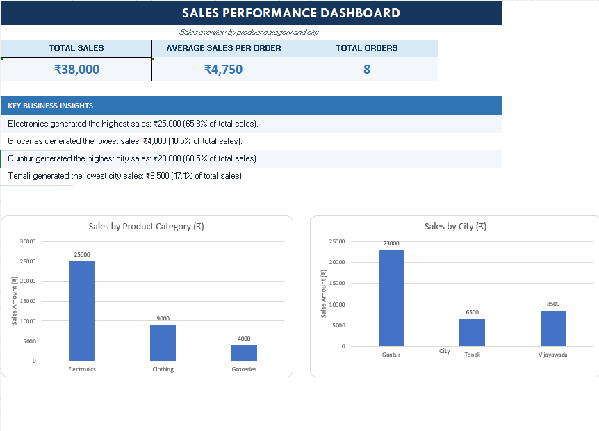

# Sales Performance Analysis Using Microsoft Excel

## Project Overview

This project analyzes sample sales data using Microsoft Excel to identify top-performing product categories and cities through data analysis, PivotTables, PivotCharts, and a dashboard.

## Tools Used

* Microsoft Excel
* Excel formulas
* PivotTables and PivotCharts
* Data analysis and visualization

## Key Performance Indicators (KPIs)

* **Total Sales:** ₹38,000
* **Average Sales per Order:** ₹4,750
* **Total Orders:** 8

## Key Findings

* **Electronics** recorded the highest category sales of ₹25,000 (65.8%).
* **Clothing** generated ₹9,000 in sales (23.7%).
* **Groceries** recorded the lowest category sales of ₹4,000 (10.5%).
* **Guntur** had the highest city sales of ₹23,000 (60.5%).
* **Tenali** had the lowest city sales of ₹6,500 (17.1%).

## Workbook Contents

* **Sales_Data:** Contains the sample sales records.
* **Category_Analysis:** Summarizes sales by product category.
* **City_Analysis:** Summarizes sales by city.
* **Dashboard:** Presents KPIs, charts, and key insights.

## How to Use

1. Download the Excel workbook from this repository.
2. Open it in Microsoft Excel.
3. Explore the analysis worksheets and dashboard.
4. Review the key findings to understand the sales distribution.

## Limitations

This project uses a small practice dataset of eight sample orders. The findings describe sales revenue only and do not establish profitability, customer demand, or long-term sales trends.

## Future Improvements

* Analyze a larger dataset.
* Add monthly sales and profit analysis.
* Build an interactive dashboard using Power BI.
* Explore additional business performance metrics.

## Author

Aspiring Data Analyst

## Dashboard Preview

